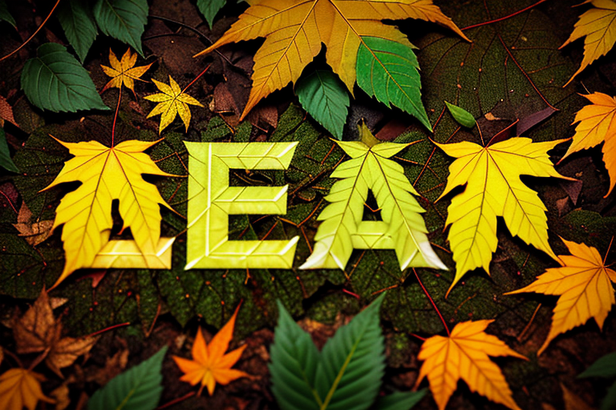

# text-font-image
## Community Node For InvokeAI

text font to text image node for InvokeAI, download a font to use (or if in font cache uses it from there), the text is always resized to the image size, but can control that with padding, optional 2nd line

* simple node textfontimage.py (Simple centered 2 line's of Texted)
* more advanced node advtextfontimage.py (gives you alot more control over text size and location)
* extrude node made by lillekemiker (keeping upto date here)

### Font dropdown (this fork)

The `local_font` dropdown lists fonts by name from:

* InvokeAI's fonts folder (`<invokeai root>/fonts`, set by `fonts_dir` in `invokeai.yaml`), including subfolders
* this node's `font_cache` folder
* installed system fonts (Windows: `C:\Windows\Fonts` and per-user fonts; Linux/macOS: the usual font folders)

To add a font, copy a `.ttf` or `.otf` file into one of those folders and restart InvokeAI. The list is built at startup.

This fork also gives `text_input_second_row` and `local_font_path` empty defaults, so the nodes run on InvokeAI 6.x without connecting those fields.

### Example workflows (this fork)

The [`workflows`](workflows) folder has two ready-made workflows. In InvokeAI, open **Workflows**, choose **Load from File** and pick a `.json` file.

**[Word Made of Leaves.json](workflows/Word%20Made%20of%20Leaves.json)** makes your word out of a material inside a full scene, for example LEAF made of leaves on a forest floor.

**[Word Made of Leaves - Transparent.json](workflows/Word%20Made%20of%20Leaves%20-%20Transparent.json)** makes the same image, then keeps only the letters. Everything outside the letter shapes is made transparent and the result is cropped to the word. The output is a transparent PNG, ready for logos, overlays and slides.

How they work: Text Font to Image renders your word as white letters on black. The QRCode Monster ControlNet uses that image to guide an SD1.5 model, so the material forms the letters. The transparent version then turns the same letter image into a mask, applies it as the alpha channel and crops to the letters.

Fields you will change most:

| Field | Description |
| ----- | ----------- |
| 1. Your Word / Text Input | The word to make |
| Local Font | Font from the dropdown (default Arial Black). Bold, heavy fonts work best |
| 2. What the word is made of | The material, e.g. leaves, stones, flowers, wood grain. Describe the material only; mentioning "letters" tends to give plain solid letters |
| 3. Word strength / Control Weight | Default 1.15. Raise it (1.3 to 1.4) if the word is hard to read; lower it (about 1.0) for a more natural look |

Requirements:

* This node pack
* An SD1.5 model (the workflows were made with DreamShaper 8)
* The **QRCode Monster v2 (SD1.5)** ControlNet, available in InvokeAI's Model Manager under Starter Models

The model and font selections were saved on one install, so after loading a workflow, re-select the SD1.5 model, the ControlNet and the font if they show as missing.

Text Font to Image Node

| Fields                  | Description                                            |
| ------------------------ | ------------------------------------------------------ |
| text_input               | The text from which to generate an image               |
| text_input_second_row    | The second row of text to add below the first text     |
| second_row_font_size     | Font size for the second row of text (optional)        |
| font_url                | URL address of the font file to download               |
| local_font_path         | Local font file path (overrides font_url)              |
| local_font              | Font dropdown: InvokeAI's fonts folder, the node's font_cache folder and installed system fonts (overrides local_font_path and font_url) |
| image_width              | Width of the output image                              |
| image_height             | Height of the output image                             |
| padding                  | Padding around the text in pixels                       |
| row_gap                  | Gap between the two rows of text in pixels 

Advanced Text Font to Image Node

| Fields                  | Description                                            |
| ------------------------ | ------------------------------------------------------ |
| text_input               | The text from which to generate an image               |
| text_input_second_row    | The second row of text to add below the first text     |
| font_url                | URL address of the font file to download               |
| local_font_path         | Local font file path (overrides font_url)              |
| local_font              | Font dropdown: InvokeAI's fonts folder, the node's font_cache folder and installed system fonts (overrides local_font_path and font_url) |
| image_width              | Width of the output image                              |
| image_height             | Height of the output image                             |
| font_color_first         | Font color for the first row of text in HEX format     |
| x_position_first         | X position of the first row of text                    |
| y_position_first         | Y position of the first row of text                    |
| rotation_first           | Rotation angle of the first row of text (in degrees)   |
| font_size_first          | Font size for the first row of text                     |
| font_color_second        | Font color for the second row of text in HEX format    |
| x_position_second        | X position of the second row of text                   |
| y_position_second        | Y position of the second row of text                   |
| rotation_second          | Rotation angle of the second row of text (in degrees)  |
| font_size_second         | Font size for the second row of text                    |
| base_image               | An image to place the text onto      |

## Example Workflow

## Examples
using Results after using the @LilleKemiker extrude node and depth controlnet

